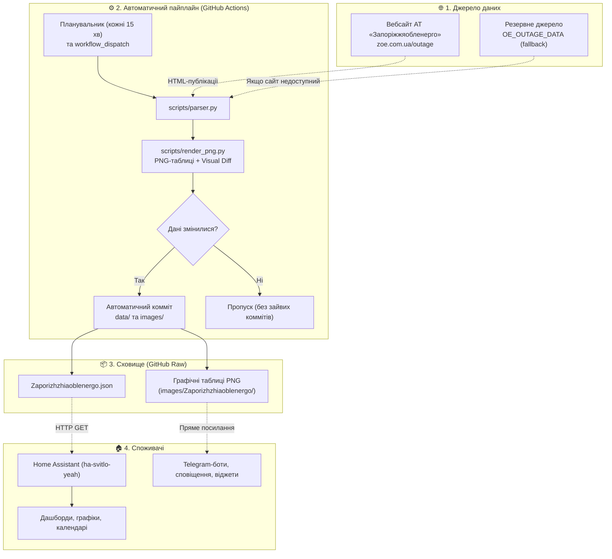

# ⚡ GPV ZOE Zaporizhzhia — Дані та наочні графіки відключень для Запоріжжя

[](https://github.com/milkmann/gpv-zoe-zaporizhzhia/actions/workflows/update.yml)

Автоматичний парсер та генератор актуальних даних погодинних відключень електроенергії (ГПВ) для споживачів міста **Запоріжжя та області**, що агрегує публікації з офіційного вебресурсу АТ «Запоріжжяобленерго» ([zoe.com.ua/outage](https://www.zoe.com.ua/outage/)).

Вихідний розклад формується у двох форматах:
1. **Стандартизований JSON** (схема DTEK / OE) — основне джерело даних для інтеграції Home Assistant:
   👉 **[ALERTua/ha-svitlo-yeah (Світло Є)](https://github.com/ALERTua/ha-svitlo-yeah)**.
2. **Наочні графічні таблиці (PNG)** — із підсумком годин без світла та підсвіткою змін (**Visual Diff**) для зручного перегляду з телефону, публікації в Telegram або відображення на дашбордах.

---

## 🔗 Пряме посилання на файл даних (Raw JSON)

```text
https://github.com/milkmann/gpv-zoe-zaporizhzhia/raw/main/data/Zaporizhzhiaoblenergo.json
```

---

## 🖼️ Наочні графічні розклади (PNG)

Таблиці генеруються автоматично на основі останнього опублікованого графіку, показують загальну кількість годин без світла за добу та виділяють зміни відносно попередньої версії (**червона рамка** — більше відключень, **зелена рамка** — менше відключень):

* **Зведені таблиці всіх черг:**
  - [На сьогодні (`gpv-all-today.png`)](https://raw.githubusercontent.com/milkmann/gpv-zoe-zaporizhzhia/main/images/Zaporizhzhiaoblenergo/gpv-all-today.png)
  - [На завтра (`gpv-all-tomorrow.png`)](https://raw.githubusercontent.com/milkmann/gpv-zoe-zaporizhzhia/main/images/Zaporizhzhiaoblenergo/gpv-all-tomorrow.png)
* **Графіки за чергами (сьогодні + завтра):**
  - [Черга 1.1](https://raw.githubusercontent.com/milkmann/gpv-zoe-zaporizhzhia/main/images/Zaporizhzhiaoblenergo/gpv-1-1-emergency.png) | [Черга 1.2](https://raw.githubusercontent.com/milkmann/gpv-zoe-zaporizhzhia/main/images/Zaporizhzhiaoblenergo/gpv-1-2-emergency.png)
  - [Черга 2.1](https://raw.githubusercontent.com/milkmann/gpv-zoe-zaporizhzhia/main/images/Zaporizhzhiaoblenergo/gpv-2-1-emergency.png) | [Черга 2.2](https://raw.githubusercontent.com/milkmann/gpv-zoe-zaporizhzhia/main/images/Zaporizhzhiaoblenergo/gpv-2-2-emergency.png)
  - [Черга 3.1](https://raw.githubusercontent.com/milkmann/gpv-zoe-zaporizhzhia/main/images/Zaporizhzhiaoblenergo/gpv-3-1-emergency.png) | [Черга 3.2](https://raw.githubusercontent.com/milkmann/gpv-zoe-zaporizhzhia/main/images/Zaporizhzhiaoblenergo/gpv-3-2-emergency.png)
  - [Черга 4.1](https://raw.githubusercontent.com/milkmann/gpv-zoe-zaporizhzhia/main/images/Zaporizhzhiaoblenergo/gpv-4-1-emergency.png) | [Черга 4.2](https://raw.githubusercontent.com/milkmann/gpv-zoe-zaporizhzhia/main/images/Zaporizhzhiaoblenergo/gpv-4-2-emergency.png)
  - [Черга 5.1](https://raw.githubusercontent.com/milkmann/gpv-zoe-zaporizhzhia/main/images/Zaporizhzhiaoblenergo/gpv-5-1-emergency.png) | [Черга 5.2](https://raw.githubusercontent.com/milkmann/gpv-zoe-zaporizhzhia/main/images/Zaporizhzhiaoblenergo/gpv-5-2-emergency.png)
  - [Черга 6.1](https://raw.githubusercontent.com/milkmann/gpv-zoe-zaporizhzhia/main/images/Zaporizhzhiaoblenergo/gpv-6-1-emergency.png) | [Черга 6.2](https://raw.githubusercontent.com/milkmann/gpv-zoe-zaporizhzhia/main/images/Zaporizhzhiaoblenergo/gpv-6-2-emergency.png)

---

## 📊 Архітектура та схема роботи



---

## ⚙️ Особливості роботи

1. **Регулярне опитування джерела:**
   - Робочий процес GitHub Actions запускається кожні **15 хвилин** (а також миттєво через `workflow_dispatch`).
   - Нові комміти фіксуються виключно за умови фактичної зміни розкладу або зміни календарної доби.
2. **Оперативна обробка коригувань протягом доби та Visual Diff:**
   - При публікації оновлених розпоряджень парсер обирає найостаннішу версію для поточної та наступної доби.
   - Рендерер порівнює актуальний графік із попередньою версією в історії Git та підсвічує змінені слоти червоною (більше відключень) або зеленою (менше відключень) рамкою.
3. **Повна сітка черг (12 підчерг) і 30-хвилинна точність:**
   - Формуються дані для всіх 6 черг із підчергами: `GPV1.1` – `GPV6.2`.
   - Зсуви на пів години (наприклад, `10:30 – 13:30`) транслюються у маркери `first` (перші 30 хв) та `second` (другі 30 хв).
4. **Коректна обробка періодів без обмежень та аварійних повідомлень:**
   - Оголошення про відсутність обмежень для населення заповнюють слоти значенням `yes` («Світло є»).
   - Повідомлення про скасування ГАВ/СГАВ (коли ГПВ продовжують діяти) не перезаписують чинний погодинний графік.
5. **Стійкість та резервування:**
   - За недоступності або геоблокування `zoe.com.ua` на хмарних раннерах парсер використовує резервне джерело (`yaroslav2901/OE_OUTAGE_DATA`) з перевіркою свіжості, щоб уникнути відкату на застарілі дані.

---

## 🏠 Підключення до Home Assistant

Репозиторій **вже інтегровано «з коробки»** в [ALERTua/ha-svitlo-yeah](https://github.com/ALERTua/ha-svitlo-yeah) як основне джерело даних для Запоріжжя. Достатньо встановити інтеграцію через HACS та обрати **Запоріжжя** і свою чергу в інтерфейсі Home Assistant (**Налаштування → Пристрої та служби → Додати інтеграцію → Svitlo Yeah**).

<details>
<summary>Для розробників: формат JSON та конфігурація джерела</summary>

Посилання в `custom_components/svitlo_yeah/const.py`:

```python
DTEK_PROVIDER_URLS = {
    ...
    "zaporizhzhia": [
        "https://github.com/milkmann/gpv-zoe-zaporizhzhia/raw/main/data/Zaporizhzhiaoblenergo.json",
        "https://github.com/yaroslav2901/OE_OUTAGE_DATA/raw/main/data/Zaporizhzhiaoblenergo.json",
    ],
}
```

Ключові поля `data/Zaporizhzhiaoblenergo.json`:
- `fact.today` — Unix timestamp півночі поточної доби (`Europe/Kyiv`)
- `fact.update` — час останнього оновлення графіку (`DD.MM.YYYY HH:MM`)
- `fact.data["<timestamp>"]["GPV1.1"]["1".."24"]` — статуси годин:
  - `yes` — світло є
  - `no` — відключення всю годину
  - `first` / `second` — відключення перші / другі 30 хвилин
  - `maybe` / `mfirst` / `msecond` — можливе відключення

</details>

---

## 🛠️ Локальний запуск та тестування

```bash
pip install -r requirements.txt

# Парсинг актуального розкладу
python scripts/parser.py

# Генерація PNG-графіків
python scripts/render_png.py --json data/Zaporizhzhiaoblenergo.json --out images/Zaporizhzhiaoblenergo

# Запуск тестів
python -m unittest discover -s tests -v
```

---

## 🌐 Офіційні ресурси обленерго

* Вебсторінка з оголошеннями ГПВ: [https://www.zoe.com.ua/outage/](https://www.zoe.com.ua/outage/)
* Інформаційний канал Telegram: [@Zaporizhzhyaoblenergo_news](https://t.me/Zaporizhzhyaoblenergo_news)
* Telegram-бот обслуговування: [@ZPenergoBot](https://t.me/ZPenergoBot)

---

## 📄 Ліцензія

Проєкт поширюється за ліцензією [MIT](LICENSE).
