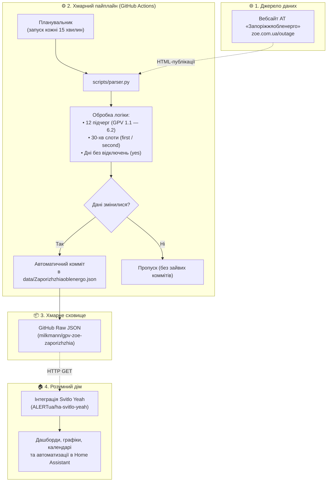

# ⚡ GPV ZOE Zaporizhzhia — Дані графіків відключень для Запоріжжя

[](https://github.com/milkmann/gpv-zoe-zaporizhzhia/actions/workflows/update.yml)

Автоматичний парсер та генератор актуальних даних погодинних відключень електроенергії (ГПВ) для споживачів міста **Запоріжжя та області**, що агрегує публікації з офіційного вебресурсу ПАТ «Запоріжжяобленерго» ([zoe.com.ua/outage](https://www.zoe.com.ua/outage/)).

Вихідний розклад формується у стандартизованій структурі JSON (схема DTEK / OE), розробленій для прямої сумісності з модулями розумного дому, зокрема з популярною інтеграцією Home Assistant:
👉 **[ALERTua/ha-svitlo-yeah (Світло Є)](https://github.com/ALERTua/ha-svitlo-yeah)**.

---

## 🔗 Пряме посилання на файл даних (Raw JSON)

```text
https://github.com/milkmann/gpv-zoe-zaporizhzhia/raw/main/data/Zaporizhzhiaoblenergo.json
```

---

## 📊 Архітектура та схема роботи



---

## ⚙️ Особливості роботи парсера

1. **Регулярне опитування джерела:**
   - Робочий процес GitHub Actions перевіряє офіційний сайт щохвилини/кожні **15 хвилин**.
   - Нові комміти фіксуються виключно за умови фактичної зміни розкладу або статусу відключень.
2. **Оперативна обробка коригувань протягом доби:**
   - При публікації оновлених розпоряджень протягом дня парсер автоматично обирає найостаннішу версію для поточної та наступної доби.
3. **Повна сітка черг (12 груп):**
   - Формуються дані для всіх 6 черг з урахуванням підгруп: `GPV1.1` – `GPV6.2`.
4. **Врахування 30-хвилинних інтервалів:**
   - Зрушення на пів години (наприклад, `10:30 – 13:30`) автоматично транслюються у відповідні маркери `first` (перші пів години) та `second` (другі пів години).
5. **Коректна обробка періодів без обмежень:**
   - Якщо офіційно повідомлено про відсутність застосування графіків для населення, слоти заповнюються значенням `yes` («Світло є»), запобігаючи неправдивим тривогам або зависанню застарілих даних.
6. **Автономність та стійкість:**
   - Рішення реалізовано на вбудованих бібліотеках Python 3 без зовнішніх пакетів.
   - У випадку мережевих збоїв або тимчасової недоступності сайту-джерела наявний стан зберігається без руйнування JSON-файлу.

---

## 🏠 Підключення до Home Assistant

Файл може використовуватися як основне або резервне джерело даних для інтеграції `svitlo_yeah`:

```python
# custom_components/svitlo_yeah/const.py
DTEK_PROVIDER_URLS = {
    ...
    "zaporizhzhia": [
        "https://github.com/milkmann/gpv-zoe-zaporizhzhia/raw/main/data/Zaporizhzhiaoblenergo.json",
        "https://github.com/yaroslav2901/OE_OUTAGE_DATA/raw/main/data/Zaporizhzhiaoblenergo.json",
    ],
}
```

---

## 🌐 Офіційні ресурси обленерго
* Вебсторінка з оголошеннями ГПВ: [https://www.zoe.com.ua/outage/](https://www.zoe.com.ua/outage/)
* Інформаційний канал Telegram: [@Zaporizhzhyaoblenergo_news](https://t.me/Zaporizhzhyaoblenergo_news)
* Telegram-бот обслуговування: [@ZPenergoBot](https://t.me/ZPenergoBot)
